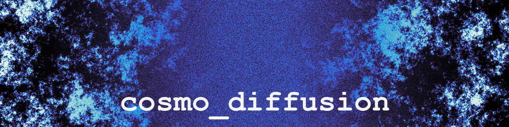

Train 2D/3D diffusion (and flow-matching) models — UNet, UNet-Conditional, DiT,
and PixArt — for cosmological applications.

## Install

```bash
git clone https://github.com/nkern/cosmo_diffusion
cd cosmo_diffusion
pip install -e .
```

## Dependencies

- `numpy`
- `torch`
- `diffusers`
- `accelerate`
- `tqdm`
- `pyyaml`
- `scipy`
- `h5py`
- `matplotlib`
- `ema-pytorch`

## Quick demo

Configure a training run in `cosmodiff/data/config.yaml` (paths, model,
scheduler, training kwargs), then launch:

```bash
cosmodiff_train.py --config path/to/config.yaml
```

The data are assumed to be stored as batches of 3D boxes with shape (Nbatch, D, H, W).
Checkpoints and metrics are written automatically to the `output_dir` set in
the config. If `output_dir=./checkpoints` and `checkpoint_every_n_epochs=10`, then the outputs will look like:

```
checkpoints/
├── checkpoint-epoch-0009/
│   ├── model/
│   └── ema_model/
├── checkpoint-epoch-0019/
│   ├── model/
│   └── ema_model/
├── ...
└── metrics.json
```

To sample from a checkpoint:

```bash
cosmodiff_sample.py --config path/to/config.yaml \
    --checkpoints_dir /path/to/checkpoints \
    --n_samples 100 \
    --filepath ./samples.npz
```

The `generate:` section of the config supplies the sampling defaults; any flag
passed on the command line overrides the corresponding config value.
`--checkpoints_dir` is the training output directory containing the
`checkpoint-epoch-NNNN/` subdirectories; when omitted, `io.output_dir` from the
config is used.  `--checkpoint_epoch` selects a specific epoch (e.g. 19 →
`checkpoint-epoch-0019`); when omitted, the latest checkpoint is used.  The
output `.npz` always contains `samples` and `ckpt_path`, plus the full config
dictionary when `--config` is provided.

For fast inference, swap in a higher-order solver:

```bash
cosmodiff_sample.py --config path/to/config.yaml \
    --checkpoints_dir /path/to/output \
    --checkpoint_epoch 50 \
    --n_samples 100 \
    --filepath ./samples.npz \
    --scheduler DPMSolverMultistepScheduler \
    --num_steps 25
```

## Fresh DiT zero initialization

To opt a new DiT training run into zero modulation/output initialization, add
`initialization: adaln_zero` alongside `class` and `kwargs` in the model config:

```yaml
model:
  class: DiTTransformer2DModel
  initialization: adaln_zero
  kwargs:
    sample_size: 128
    patch_size: 8
    in_channels: 1
    out_channels: 1
    num_layers: 16
    num_attention_heads: 12
    attention_head_dim: 64
    num_embeds_ada_norm: 1000
    norm_type: ada_norm_zero
```

Keep the architecture arguments appropriate for your run; the policy does not
change them. It zeroes the weight and bias of every block's `norm1.linear`
(attention/FFN shifts, scales, and residual gates), plus `proj_out_1` (final
conditioning) and `proj_out_2` (prediction head). Initially, the blocks are
identity mappings and the denoising prediction is zero; these values are not
frozen and training learns them. Attention, FFN, and embedding weights retain
their native initialization.

This implements the zero-modulation/output part of
[Peebles and Xie's DiT initialization](https://arxiv.org/abs/2212.09748), not
the complete reference initialization or training recipe. Omitted
`initialization`, or `initialization: native`, preserves existing behavior.
Only native `DiTTransformer2DModel` with `norm_type: ada_norm_zero` is supported;
incompatible projection APIs fail before any weights are zeroed. This policy
was checked with diffusers 0.38.0 without imposing a version pin.

Initialization is applied only when constructing a fresh model. Resuming or
sampling a checkpoint does **not** zero its trained weights. Enabling this
option does not retrofit an already-trained checkpoint or guarantee improved
generation for every dataset or model depth.

## Authors

- Nicholas Kern
- Jiaming Pan
